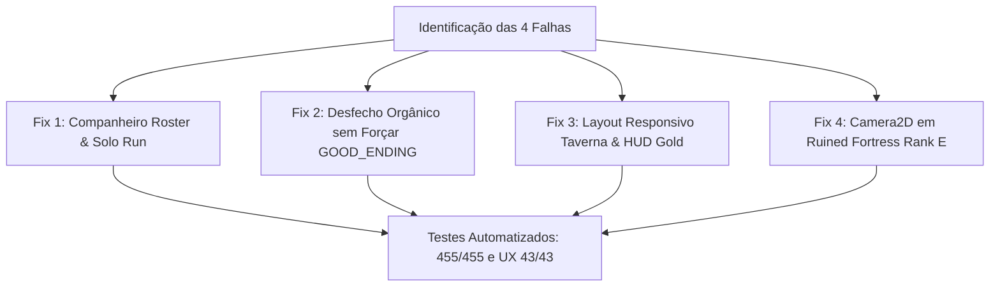

# Plano de Correção: Companheiro Não Contratado, Cálculo de Desfecho, Quebra de UI e Câmera do Rank E

> [!NOTE]
> Este plano foi estruturado para ser enviado diretamente para o agente/desenvolvedor **Jules** para execução e correção precisa dos 3 apontamentos e do comportamento dos companheiros.

---

## 1. Contexto & Diagnóstico dos Problemas

### Problema A: Mago surgiu sem ser contratado e traição/morte no chefe
- **Causa Raiz 1 (Spawn não solicitado)**: No script [`scripts/arena/arena.gd`](file:///c:/Users/Rodrigo%20Brasil/Documents/antigravity/mysterious-hopper/scripts/arena/arena.gd#L102-L116), quando `roster.size() == 0`, o código estava gerando um Mago (`companion_mage.tscn`) por padrão para satisfazer testes automatizados isolados de arena (`T4.01`). Isso fez com que em expedições solo um mago aparecesse sem ter sido recrutado na taverna.
- **Causa Raiz 2 (Traição / Falso Colapso)**: O Mago possui o perfil de Eneagrama com estresse. Na batalha do chefe, sob dano e acúmulo de estresse sem ordens de liderança, o aliado entra em colapso/morre (`allies_fallen = 1`), emitindo `ally_died`.

### Problema 1: Pontuação e Desfecho Inconsistente (Imagem 1)
- **Causa Raiz**:
  - Na imagem 1, o título exibido é **"A Aliança dos Vivos [ DESFECHO DE AGÊNCIA ORGÂNICA ]"** com texto heróico de lealdade, porém os números registram:
    - *Companheiros Sobreviventes*: 0
    - *Baixas em Combate*: 1
    - *Pontuação de Agência*: -35
  - Isso ocorreu porque em [`scripts/arena/arena.gd`](file:///c:/Users/Rodrigo%20Brasil/Documents/antigravity/mysterious-hopper/scripts/arena/arena.gd#L86-L87), ao entrar no portal de vitória, o código forçou:
    `gm.call("trigger_ending", "GOOD_ENDING")`
    sobrepondo o julgamento orgânico do [`SilentAgencyTracker`](file:///c:/Users/Rodrigo%20Brasil/Documents/antigravity/mysterious-hopper/scripts/autoloads/agency_tracker.gd#L94-L103) que avaliaria para `"BAD_ENDING"` (O Monstro Solitário) quando a pontuação é negativa (-35) ou quando não há aliados sobreviventes.
  - Além disso, se o jogador opta por jogar solo (sem contratar ninguém), a pontuação deve refletir expedição solitária sem companheiros fantasmas computados como mortos.

### Problema 2: Texto do Ouro e Modal da Taverna Quebrando na Tela (Imagem 2)
- **Causa Raiz**:
  - Na tela da Taverna ([`scenes/ui/modals/tavern_recruit_modal.tscn`](file:///c:/Users/Rodrigo%20Brasil/Documents/antigravity/mysterious-hopper/scenes/ui/modals/tavern_recruit_modal.tscn)), o `PanelContainer` tem altura fixa `310px` e os cartões de 4 mercenários criados em [`scripts/ui/modals/tavern_recruit_modal.gd`](file:///c:/Users/Rodrigo%20Brasil/Documents/antigravity/mysterious-hopper/scripts/ui/modals/tavern_recruit_modal.gd#L136-L188) possuem textos longos de citações e habilidades, fazendo o conteúdo vazar verticalmente para fora do painel.
  - A mensagem `"Ouro insuficiente!"` e a barra de rodapé ficam espremidas na borda inferior cortando as palavras.
  - No HUD de combate ([`scenes/ui/hud/hud.tscn`](file:///c:/Users/Rodrigo%20Brasil/Documents/antigravity/mysterious-hopper/scenes/ui/hud/hud.tscn) / [`scripts/ui/hud.gd`](file:///c:/Users/Rodrigo%20Brasil/Documents/antigravity/mysterious-hopper/scripts/ui/hud.gd#L61-L71)), o `GoldLabel` precisa de margem e separação adequadas para não sobrepor abates/tempo ou quebrar linha.

### Problema 3: Câmera Desconfigurada na Fase do Rank E / Ruined Fortress (Imagem 3)
- **Causa Raiz**:
  - Na cena [`scenes/dungeon/ruined_fortress.tscn`](file:///c:/Users/Rodrigo%20Brasil/Documents/antigravity/mysterious-hopper/scenes/dungeon/ruined_fortress.tscn#L70), a instância do jogador não possui um nó `Camera2D` filho (diferente de `scenes/arena/arena.tscn` e `scenes/hub/greyrock_village.tscn`).
  - Como não há `Camera2D` anexado ao Player ou na cena, a viewport renderiza na coordenada fixa `(0, 0)` no canto superior esquerdo com espaço cinza vazio na parte inferior e direita.
  - O mapa da Ruined Fortress tem dimensões `900x600` (limites aproximados de `-450` a `450` em X e `-300` a `300` em Y). Sem limites de câmera ou sem câmera seguindo o Player, a visão do jogador fica cortada e desalinhada.

---

## 2. Instruções de Implementação para o Jules



### Tarefa 1: Corrigir o Spawn Indesejado de Companheiro na Arena
- **Arquivo**: [`scripts/arena/arena.gd`](file:///c:/Users/Rodrigo%20Brasil/Documents/antigravity/mysterious-hopper/scripts/arena/arena.gd)
- **Ação**:
  - Em `_setup_party_roster()`, **NÃO** instanciar um `companion_mage.tscn` se `roster.size() == 0` durante o jogo normal iniciado a partir do Hub da Vila (`GameManager.active_party_roster.size() == 0`).
  - Para manter a compatibilidade do teste automatizado de montagem `T4.01` (`tests/tier4_gameplay_scenarios.gd`), verificar se a cena foi carregada standalone sem GameManager ou se há uma flag de teste, OU permitir que o teste monte o comp quando requisitado sem injetar um companheiro na partida de quem jogou solo.
  - Se o jogador não contratou ninguém na taverna, `active_party_roster` é vazio: **nenhum companheiro deve aparecer na partida**.

---

### Tarefa 2: Corrigir o Cálculo de Pontuação e Tipo de Desfecho
- **Arquivo**: [`scripts/arena/arena.gd`](file:///c:/Users/Rodrigo%20Brasil/Documents/antigravity/mysterious-hopper/scripts/arena/arena.gd#L86-L89)
- **Ação**:
  - No método `_on_portal_entered(body)`:
    - **Remover** o argumento forçado `"GOOD_ENDING"` da chamada:
      ```gdscript
      # ERRADO: gm.call("trigger_ending", "GOOD_ENDING")
      # CORRETO:
      gm.call("trigger_ending")
      ```
    - O [`GameManager.trigger_ending()`](file:///c:/Users/Rodrigo%20Brasil/Documents/antigravity/mysterious-hopper/scripts/autoloads/game_manager.gd#L185-L203) consultará o [`SilentAgencyTracker.evaluate_ending()`](file:///c:/Users/Rodrigo%20Brasil/Documents/antigravity/mysterious-hopper/scripts/autoloads/agency_tracker.gd#L94-L103).
    - Se a pontuação for negativa (`-35`) ou se o jogador for solo sem aliados vivos, o desfecho será corretamente **"O Monstro Solitário" (BAD_ENDING)**, e não "A Aliança dos Vivos".
    - Na tela [`EndingScreen`](file:///c:/Users/Rodrigo%20Brasil/Documents/antigravity/mysterious-hopper/scripts/ui/ending_screen.gd), os textos e cores baterão 100% com as métricas de conduta da partida.

---

### Tarefa 3: Corrigir Layout da Taverna (Ouro e Textos Cortados)
- **Arquivos**:
  - [`scenes/ui/modals/tavern_recruit_modal.tscn`](file:///c:/Users/Rodrigo%20Brasil/Documents/antigravity/mysterious-hopper/scenes/ui/modals/tavern_recruit_modal.tscn)
  - [`scripts/ui/modals/tavern_recruit_modal.gd`](file:///c:/Users/Rodrigo%20Brasil/Documents/antigravity/mysterious-hopper/scripts/ui/modals/tavern_recruit_modal.gd)
  - [`scripts/ui/hud.gd`](file:///c:/Users/Rodrigo%20Brasil/Documents/antigravity/mysterious-hopper/scripts/ui/hud.gd)
- **Ações**:
  1. **Taverna**:
     - No script da Taverna, adicionar um label destacado para o saldo atual do jogador: `"💰 Seu Ouro: %d"` no Header ou no topo da lista de recrutamento.
     - Ajustar o tamanho dos cartões (`_create_candidate_card`) para caber confortavelmente dentro do Viewport de 640x360 sem overflow:
       - Limitar o tamanho do `RumorPanel` para não empurrar os cards para fora.
       - Aumentar o `PanelContainer` ou encapsular os cartões num `ScrollContainer` / diminuir margens e fontes para evitar que botões de contratar e a mensagem de ouro insuficiente transbordem a tela.
  2. **HUD**:
     - Em `_setup_gold_hud()` no [`hud.gd`](file:///c:/Users/Rodrigo%20Brasil/Documents/antigravity/mysterious-hopper/scripts/ui/hud.gd), garantir que o `GoldLabel` tenha `clip_text = false` e margem adequada abaixo de `TimeLabel`, com `autowrap_mode = TextServer.AUTOWRAP_OFF`.

---

### Tarefa 4: Adicionar e Configurar Camera2D na Fase do Rank E (Ruined Fortress)
- **Arquivos**:
  - [`scenes/dungeon/ruined_fortress.tscn`](file:///c:/Users/Rodrigo%20Brasil/Documents/antigravity/mysterious-hopper/scenes/dungeon/ruined_fortress.tscn)
  - [`scripts/dungeon/ruined_fortress.gd`](file:///c:/Users/Rodrigo%20Brasil/Documents/antigravity/mysterious-hopper/scripts/dungeon/ruined_fortress.gd)
- **Ações**:
  - Anexar um nó `Camera2D` ao `Player` dentro de `ruined_fortress.tscn` (ou instanciá-lo programaticamente em `_ready()`):
    ```gdscript
    var cam := Camera2D.new()
    cam.name = "Camera2D"
    cam.position_smoothing_enabled = true
    cam.position_smoothing_speed = 8.0
    cam.limit_left = -460
    cam.limit_top = -310
    cam.limit_right = 460
    cam.limit_bottom = 310
    player.add_child(cam)
    ```
  - Configurar os limites da câmera de acordo com as dimensões da arena da fortaleza (`Floor`: `offset_left = -460`, `offset_top = -310`, `offset_right = 460`, `offset_bottom = 310`).
  - Isso centraliza a visão no jogador e elimina as bordas cinzas vazias da tela mostradas na imagem 3.

---

## 3. Critérios de Aceite & Validação
1. **Partida Solo**: Iniciar expedição na vila sem recrutar ninguém -> Nenhum mago/aliado deve ser gerado na fase; nenhuma morte de aliado deve ser computada no final.
2. **Desfecho Coerente**: Se o score for negativo ou se aliados morrerem, a tela de fim de jogo deve exibir **"O Monstro Solitário" (BAD_ENDING)** com paleta carmesim/cinza, e **"A Aliança dos Vivos" (GOOD_ENDING)** somente com pontuação positiva e aliados vivos.
3. **UI Taverna & Ouro**: Todo o texto dos 4 mercenários, custo em ouro e mensagem de status devem estar 100% visíveis dentro da janela do jogo sem cortes.
4. **Câmera Rank E**: Ao entrar na Ruined Fortress (Rank E / D), a câmera deve seguir o jogador suavemente e respeitar as paredes da fortaleza sem barras cinzas desproporcionais.
5. **Testes Godot**: Execução de `tests/test_runner.gd` e `tests/test_ux_refactor_suite.gd` com **0 falhas**.
