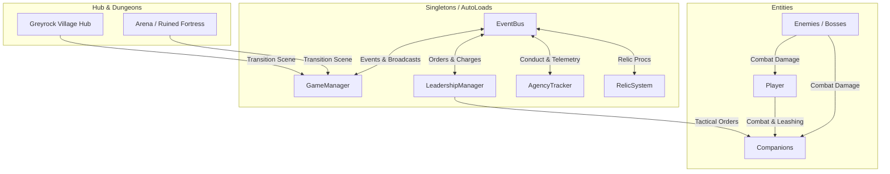

# Documentação Técnica: Shadow Cheat — Solo Guild Ascendance

## 1. Visão Geral do Projeto

**Shadow Cheat: Solo Guild Ascendance** é um RPG tático de ação roguelike top-down desenvolvido na engine **Godot 4.6.1+**. O jogo combina mecânicas dinâmicas de combate com hack-and-slash, gerenciamento de grupo/guilda (party management) no vilarejo Hub (**Greyrock Village**) e expedições em dungeons e arenas contra hordas e chefes guardiões.

Um dos pilares arquiteturais centrais do jogo é o **Sistema de Liderança Psicológica e Conduta Silenciosa**, onde os companheiros possuem personalidades baseadas no **Eneagrama**, reagindo aos comandos do jogador (Atacar, Recuar, Socorrer) de acordo com o nível de estresse, proximidade e integridade tática. Suas ações e lealdade guiam organicamente o desfecho do jogo (múltiplos finais) sem medidores morais artificiais.

---

## 2. Especificações do Motor e Configurações de Display

| Parâmetro | Configuração | Detalhes |
|---|---|---|
| **Engine** | Godot Engine 4.6.1 Stable | Modo de renderização Forward Plus / Canvas 2D |
| **Resolução Base** | 640 x 360 | Canvas nativo pixel-art 16:9 |
| **Resolução de Janela** | 1280 x 720 | Window override padrão para inicialização desktop |
| **Stretch Mode** | `canvas_items` | Redimensionamento nítido mantendo proporções 2D |
| **Stretch Aspect** | `keep` | Impede deformações e bordas assimétricas |
| **Texture Filter** | `nearest` | Pixel snapping ativo, preservando a arte em pixels |
| **Movimento Físico** | `MOTION_MODE_FLOATING` | Top-down sem gravidade para todas as entidades móveis |

---

## 3. Arquitetura de Software e Padrões Globais

O projeto adota o princípio canônico de Godot **"Signal Up, Call Down"**:
- **Nós Superiores / Gerenciadores**: Chamam métodos diretamente em seus nós filhos (`call down`).
- **Nós Inferiores / Entidades**: Disparam sinais tipados (`signal up`) para comunicar eventos e alterações de estado.
- **AutoLoads / Singletons**: Atuam como barramentos centrais desacoplados de comunicação entre sistemas independentes.

---

## 4. Singletons / AutoLoads

### 4.1. `GameManager` (`scripts/autoloads/game_manager.gd`)
- **Responsabilidade**: Gerenciamento de ciclo de vida do jogo, persistência do grupo (`active_party_roster`), ranque de expedição atual (`selected_quest_rank`) e transição fluida entre cenas com efeito de fade (`0.35s`).
- **Constantes de Cenas**:
  - `SCENE_HUB`: `res://scenes/hub/greyrock_village.tscn`
  - `SCENE_ARENA`: `res://scenes/arena/arena.tscn`
  - `SCENE_FORTRESS`: `res://scenes/dungeon/ruined_fortress.tscn`
- **Balanceamento Dinâmico**: Aplica multiplicadores globais de dificuldade para HP e dano de monstros e chefes com base no ranque da missão (F a S).

### 4.2. `LeadershipManager` (`scripts/autoloads/leadership_manager.gd`)
- **Responsabilidade**: Gerencia a emissão e validação de ordens táticas pelo jogador:
  - `[1] ATTACK`: Foco em alvo ou área ofensiva.
  - `[2] RETREAT`: Retirada defensiva em direção ao jogador.
  - `[3] HELP`: Assistência prioritária ao jogador ou aliados sob pressão.
- **Sistema de Cargas**:
  - Capacidade máxima: 3 cargas.
  - Recarga automática: Ganha 1 carga a cada 10 inimigos abatidos.
  - Debounce de entrada: `0.15s` para evitar consumo duplo acidental.

### 4.3. `AgencyTracker` (`scripts/autoloads/agency_tracker.gd`)
- **Responsabilidade**: *Silent Agency Tracker* baseado no princípio de **Zero Auxílio Interpretativo**. Registra a telemetria do jogador em tempo real sem expor barras de karma.
- **Fórmula de Pontuação de Agência (`calculate_agency_score`)**:
  $$\text{Score} = (\text{survived} \times 25) + (\text{rescues} \times 15) - (\text{fallen} \times 35) - (\text{reckless} \times 10) - (\text{abandonment} \times 15)$$
- **Critérios de Finais (`evaluate_ending`)**:
  - **O Monstro Solitário (Bad Ending)**: Expedição solo sem aliados (`allies_deployed == 0`), $\text{Score} < 0$ ou $\ge 3$ aliados mortos.
  - **A Aliança dos Vivos (Good Ending)**: $\text{Score} \ge 50$ e no máximo 1 aliado morto.

### 4.4. `EventBus` (`scripts/autoloads/event_bus.gd`)
- **Responsabilidade**: Barramento global de sinais reativos desacoplados para combate, mortes, ordens táticas, diálogos, atualizações de HUD e eventos de progressão.

### 4.5. `RelicSystem` (`scripts/systems/relic_system.gd`)
- **Responsabilidade**: Gerenciador de relíquias e bênçãos ativas da partida. Injeta modificadores cumulativos ou multiplicativos no jogador e/ou nos mercenários (ex: velocidade, vida extra, vampirismo ao abater alvos, redução de cooldowns).

---

## 5. Módulos do Sistema e Mecânicas

### 5.1. Sistema de Personalidade e Psicologia (Eneagrama)
Localizado em `scripts/personality/`, esse módulo orquestra a autonomia e obediência dos companheiros em batalha:

- **Classes Chave**:
  - `EnneagramData`: Resource com parâmetros do arquétipo (Tipo 1 ao 9, taxas de estresse, sensibilidade ao perigo, limite de pânico diante de hordas, etc.).
  - `EnneagramEvaluator`: Máquina de estados determinística (`HEALTHY`, `STRESSED`, `COLLAPSED`).
  - `TacticalContext`: Captura periódica de dados do campo de batalha (distância do jogador, contagem de ameaças ao redor, porcentagem de HP).
- **Resultados de Ordem (`OrderStatus`)**:
  - `OBEY` (Verde Esmeralda): Companheiro executa a ordem imediatamente.
  - `HESITATE` (Amarelo Âmbar): Companheiro hesita por um breve intervalo antes de acatar.
  - `REFUSE` (Vermelho Carmesim): Companheiro recusa a ordem devido a pânico extremo ou colapso mental.

### 5.2. Sistema de Combate e Entidades
Localizado em `scripts/combat/` e `scripts/entities/`:

- **Arquitetura de Componentes**:
  - `HealthComponent`: Controle de HP, imunidade pós-dano (i-frames) e emissão de sinal `died`.
  - `HitboxComponent`: Área causadora de dano, equipe (`team_index`) e tipo de dano (`DamageData.DamageType`).
  - `HurtboxComponent`: Área receptora de dano com filtragem por equipe e despacho para o `HealthComponent`.
- **Entidades Principais**:
  - `Player` (`scripts/entities/player.gd`): Movimentação ágil em 8 direções, sistema de esquiva/dash com i-frames, corte físico, atração magnética de gemas de experiência e habilidades liberadas via progressão (Pulso de Fogo, Rajada Abissal).
  - `CompanionBase` (`scripts/entities/companion_base.gd`): Base para mercenários (`Archer`, `Mage`, `Paladin`, `Rogue`), contendo lógica de atrelamento (leashing ao redor do jogador), posicionamento tático e avaliação de estresse.
  - `Enemy` / `EnemyRanged` / `BossGuardianBase`: Comportamentos de perseguição de alvos (jogador e aliados), projéteis inimigos e fases de chefão.

### 5.3. Hub e Level Design
- **Greyrock Village** (`scenes/hub/greyrock_village.tscn`):
  - 4 zonas temáticas: Praça Central, Guilda dos Aventureiros, Taverna do Repouso e Santuário de Selene.
  - NPCs interativos: Madre Selene (profecias e presságios), Elena (Quadro de Missões / Quest Board) e Barnaby (Taverna de Contratação).
  - Dimensões padrão: $640 \times 360$ com `PerimeterBoundaries` (`StaticBody2D` com $\ge 4$ formas de colisão rígidas).
- **Dungeons & Arenas**:
  - `arena.tscn`: Combate de sobrevivência por ondas, ambientação em masmorra de pedra com tochas e limites de câmera (`Camera2D` delimitada entre $(-600, -400)$ e $(600, 400)$).
  - `ruined_fortress.tscn`: Expedições de ranque elevado com monólitos de leyline e layouts labirínticos.

---

## 6. Interface de Usuário (UI & UX)

A interface segue os padrões de `godot-ui-containers` e `godot-dialogue-system`:
- **Containers Responsivos**: Uso consistente de `MarginContainer` (16–24px de padding), `HBoxContainer`, `VBoxContainer` e `PanelContainer` com tamanhos de fonte padronizados (10–12pt).
- **Modais com Overlay Escuro**:
  - Modais de Gacha, Taverna e Quadro de Missões incluem backdrop escurecido (`ColorRect` com alfa 0.65 e `mouse_filter = MOUSE_FILTER_STOP`).
  - Ocultamento automático do banner do HUD da vila quando modais são abertos para evitar conflitos visuais e cliques indesejados.
- **Caixa de Diálogo Clássica Inferior** (`scenes/ui/dialogue/bottom_dialogue_box.tscn`):
  - Posicionamento `Anchor Bottom Wide` com margens laterais de 32px e inferior de 16px (altura fixa ~80px).
  - Efeito máquina de escrever (*typewriter effect*), nome do locutor destacado e paginação via tecla `[E]` ou clique do mouse.

---

## 7. Camadas de Colisão de Física (Physics 2D Layers)

| Camada | Nome Lógico | Utilização |
|---|---|---|
| **1** | World / Obstacles | Paredes perimetrais da vila, limites de arena e rochas |
| **2** | Player | Corpo físico do jogador principal |
| **3** | Enemies | Inimigos comuns, arqueiros e chefes |
| **4** | Player Projectiles / Attacks | Hitbox da espada do jogador, projéteis aliados |
| **5** | Enemy Projectiles / Attacks | Projéteis de esqueletos, magias e ataques de área de monstros |
| **6** | Pickups / Drops | Gemas de experiência (XP), orbes de cura e moedas |
| **7** | Companions / Allies | Corpos físicos dos companheiros e mercenários da party |

---

## 8. Infraestrutura de Testes Automatizados

O projeto possui uma suíte de testes unitários, de integração e de UX executada em modo headless no Godot:
- **Runner**: `tests/test_ux_refactor_suite.gd` e suítes correlatas.
- **Total de Testes**: Mais de 450 testes cobrindo:
  - Sanidade de layouts e containers UI (prevenção de overflow).
  - Integridade física de limites de mapa e colisões.
  - Avaliador psicológico de ordens de liderança do Eneagrama.
  - Ciclo de vida e transições do `GameManager`.
  - Telemetria e cálculo determinístico dos finais do `AgencyTracker`.
